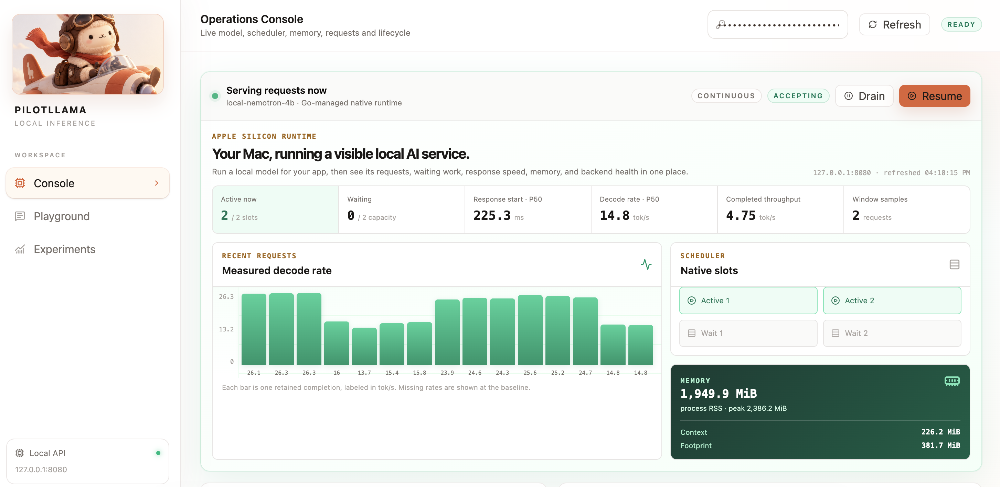
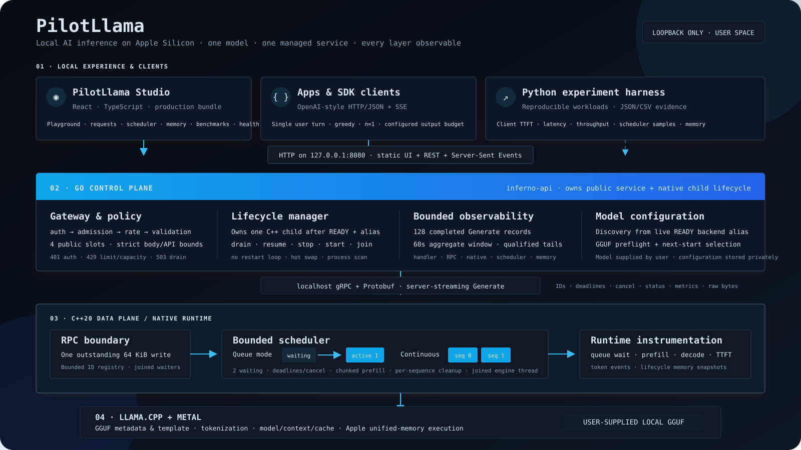
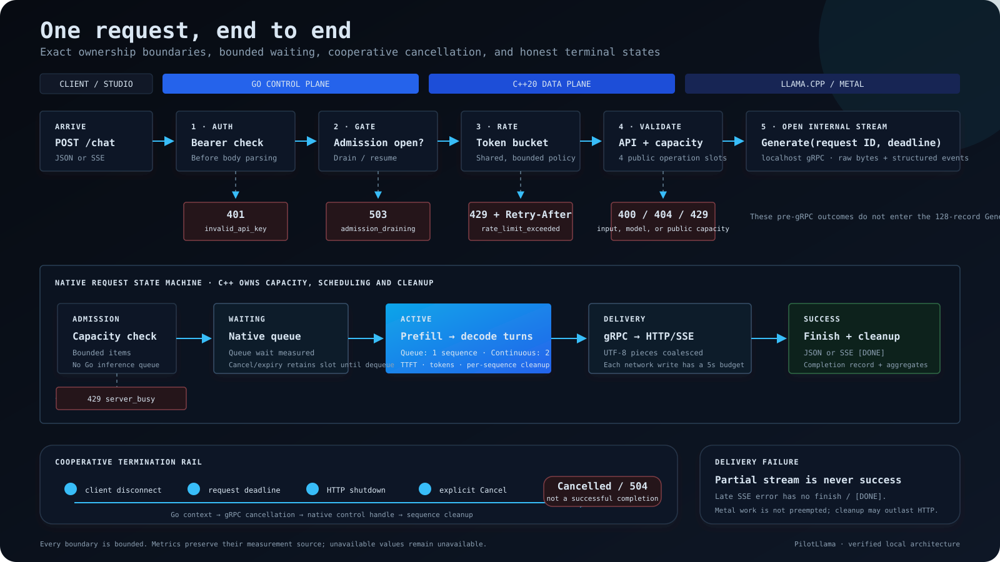

# PilotLlama

Local LLM inference infrastructure for Apple Silicon.

PilotLlama serves a user-supplied GGUF through an OpenAI-style streaming API. Go
owns the control plane; C++20 owns bounded scheduling and llama.cpp/Metal execution;
React exposes the system in a local observability Studio.





## Why PilotLlama?

Ollama makes it easy to download and run a local model. PilotLlama helps you run a
small, visible local AI service for an application.

- Your app gets a local OpenAI-style API with JSON and live streaming output.
- You can see whether requests are executing or waiting, rather than guessing why a
  response feels slow.
- You can inspect first-token time, generation speed, queue wait, memory, and backend
  health for each real request.
- You can drain requests, safely stop/start the managed backend, and test queue versus
  continuous scheduling from one local control surface.

In plain English: Ollama is excellent for running a model. PilotLlama is for running
and understanding a local AI service. It has a deliberately narrower model boundary;
Ollama remains broader for model discovery, downloads, and general compatibility.

## Capabilities

- `POST /v1/chat/completions` with JSON or SSE streaming
- bearer auth, token-bucket rate limiting, drain/resume, readiness and managed restart
- localhost gRPC server-streaming between Go and C++
- bounded queue mode or opt-in two-sequence continuous batching
- cooperative deadlines, disconnect cancellation and per-sequence cleanup
- request, scheduler, TTFT, latency, throughput and macOS memory telemetry
- React Studio: playground, request inspector, scheduler, memory, benchmarks,
  model configuration and system health
- reproducible Python benchmark runners with JSON/CSV output

## Run

Requirements:

- Apple Silicon Mac running macOS
- Xcode command-line tools
- CMake ≥3.24 and Ninja
- Go ≥1.25
- Node.js and npm
- Python 3.12

Setup fetches exact pinned project dependencies only after consent. It stays inside
the project, never uses `sudo`, and never downloads a model.

```sh
./scripts/setup.sh
./scripts/start.sh --model /absolute/path/model.gguf --model-id local-model
```

Open `http://127.0.0.1:8080/`. Later starts reuse the saved model selection:

```sh
./scripts/start.sh
./scripts/stop.sh
```

Read-only diagnostics: `./scripts/setup.sh --check`.

## Use from your app

1. Start PilotLlama with an existing local GGUF model.
2. Read the generated local bearer token.
3. Configure an OpenAI-compatible client with:
   - base URL: `http://127.0.0.1:8080/v1`
   - API key: the local bearer token
   - model: your configured PilotLlama model alias
4. Send chat-completion requests and stream responses normally.

```text
Your app → http://127.0.0.1:8080/v1 → PilotLlama → local GGUF on Metal
```

## API

```sh
TOKEN="$(cat build/pilotllama/auth.token)"

curl --no-buffer http://127.0.0.1:8080/v1/chat/completions \
  -H "Authorization: Bearer $TOKEN" \
  -H 'Content-Type: application/json' \
  -d '{
    "model":"local-model",
    "messages":[{"role":"user","content":"Explain unified memory."}],
    "max_tokens":128,
    "stream":true
  }'
```

The current API accepts one user message, greedy sampling, `n=1`, and 1–512 output
tokens. Unsupported options fail explicitly. See [the API contract](docs/public-api.md).

## Request path



Go checks authentication → admission → rate → input/public capacity, then opens a
gRPC stream. C++ admits the request into a bounded scheduler, runs llama.cpp, and
streams token bytes and metrics back. Deadlines and disconnects propagate to native
cooperative cancellation. Metal work is not preempted, so cleanup may outlast HTTP.

## Scheduling

| Mode | Native execution | Status |
| --- | --- | --- |
| `queue` | 1 active request + bounded wait queue | default |
| `continuous` | 2 active sequences + 2 waiting, one 4096-token context | opt-in; verified Nemotron configuration |

The measured two-client comparison reduced median TTFT from **1,146.7 ms to
262.3 ms** and native queue wait from **1,012.5 ms to 0.012 ms**. Throughput changed
from **23.07 to 22.04 tok/s**; PilotLlama therefore claims earlier response starts,
not higher throughput. [Method and evidence](docs/benchmarking.md).

## Model boundary

Queue mode accepts decoder-only GGUFs recognized by the pinned llama.cpp when their
embedded chat template is supported. Unknown template-less or unsupported models fail
closed. The verified Nemotron-H shape has a fixed fallback because its GGUF lacks a
template. Continuous mode is currently restricted to that shape.

No non-Nemotron model has been run in this project. There is no claim of arbitrary
GGUF, full Jinja, multimodal, tool, multi-turn or non-Nemotron batching support.
[Details](docs/model-selection.md).

## Components

```text
studio/         React + TypeScript operations UI
controlplane/   Go HTTP/SSE API, policy, lifecycle and observability
proto/          internal gRPC v1 contract
src/            C++ runtime, schedulers, llama.cpp adapter and RPC server
benchmarks/     Python workloads, runners and analysis
scripts/        user-space setup, lifecycle and verification
```

Metrics retain their source boundaries: browser, Go, RPC and native timings are not
interchangeable; RSS and llama allocations overlap; P95/P99 remain null below their
20/100-sample thresholds. See [observability](docs/observability.md) and
[memory methodology](docs/memory-observability.md).

## Verify

```sh
cmake --preset dev && cmake --build --preset dev
ctest --test-dir build/dev --output-on-failure
sh scripts/go-local.sh test -race ./...
sh scripts/go-local.sh vet ./...
.venv/bin/python -m unittest discover -s benchmarks/tests -v
sh scripts/generate-proto.sh --check
(cd studio && npm run build)
```

PilotLlama is licensed under [Apache-2.0](LICENSE). Models, dependencies, builds,
raw results, credentials and local state are excluded from the repository. The
PilotLlama mascot is original project artwork; see [NOTICE](NOTICE) and
[third-party notices](THIRD_PARTY_NOTICES.md).
